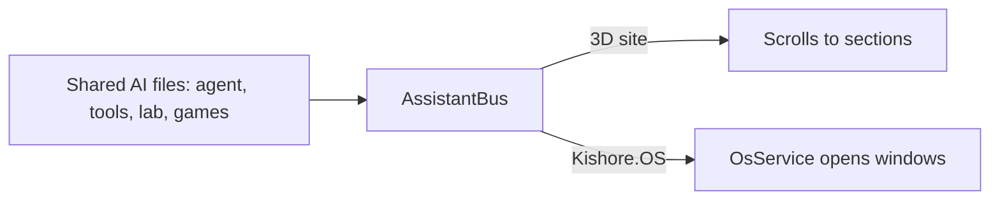

# Bringing the AI features to Kishore.OS

How to add everything built in **portfolio-3d** (66 AI options, live conversation, the new robot, the games and the AI orbit) to **portfolio-os**.

> **Status: built** on the `ai-features` branch on 26 November 2026. Not yet committed, pushed or deployed.
> All six phases are done, with all ten OS-only features. See [What was built](#what-was-built). The steps below are kept as the record of how.

- [What was built](#what-was-built)
- [The idea](#the-idea)
- [Before you start](#before-you-start)
- [What goes where](#what-goes-where)
- [Phase 1: the shared core](#phase-1-the-shared-core)
- [Phase 2: the assistant and robot](#phase-2-the-assistant-and-robot)
- [Phase 3: the AI Lab window](#phase-3-the-ai-lab-window)
- [Phase 4: connect the OS apps](#phase-4-connect-the-os-apps)
- [Phase 5: features only an OS can have](#phase-5-features-only-an-os-can-have)
- [Phase 6: offline app and deploy](#phase-6-offline-app-and-deploy)
- [What the trial showed](#what-the-trial-showed)
- [Checklist](#checklist)
- [Keeping both sites in step](#keeping-both-sites-in-step)

---

## What was built

**76 AI options:** the 66 of the 3D site and 10 that only an OS can have.

| OS-only feature | Try it | Main file |
|---|---|---|
| Tools as windows | Open two tools from the AI Lab | `lab/lab-dialog.ts`, `core/os.service.ts` |
| Window agent | "put projects next to skills", "tile everything" | `core/window-commands.ts` |
| AI terminal | Type "where did he use docker", or `lab`, `ask`, `windows`, `trace` | `apps/terminal.ts` |
| Smart Spotlight | Ctrl K, then a question | `shell/spotlight.ts` |
| Notification centre | The bell in the menu bar | `core/notification.service.ts` |
| Files app | Save a tool's result, then open Files | `apps/files.ts` |
| Robot pet | "walk around", "stop walking" | `core/pet.service.ts`, `layout/assistant.ts` |
| Wallpaper mood | Menu → Wallpaper mood | `core/wallpaper-mood.service.ts` |
| Session restore | Reload the page | `core/session.service.ts` |
| Agent activity | System Monitor → ALPHA, live | `apps/monitor.ts` |

**Where it differs from the plan**

- Tools open as **windows** (`#lab/compare`), not dialogs. The job matcher and mock interview stay dialogs, and Back closes them.
- The saved-results tool became the Files app, and the guestbook option opens the Guestbook app.
- `cleanUrls` stays on. Offline use was tested with the same redirects and works.
- `firestore.rules` was **not** changed, so approved answers and shared feedback stay off (`FIRESTORE_EXTRAS = false`).
- `npm run sync-ai` compares the shared files with portfolio-3d, and `-- --write` copies them.

**Tested** on a computer and at phone size, in dark and light: the agent tests (32 of 32), the production build (688 kB), the features above, and offline with the server stopped.
**Not tested:** real Gemini answers (App Check refuses the automated browser), a real microphone, a real phone, and the deploy.

---

## The idea

The AI code asks the page to do things through **one small class**, `AssistantBus`: open a section, show a project, notify, react. On the 3D site those mean scrolling. Here they should mean **opening windows**.

So most files can be copied unchanged. Kishore.OS only needs its own version of that class.



| Same idea | 3D site | Kishore.OS |
|---|---|---|
| Go to a place | Scroll to a section | Open a window |
| Show a project | Turn the carousel | Open Projects and select it |
| AI section | A page section | An **AI Lab** app in the dock |
| Tool address | `/lab/compare` | `#lab/compare` |
| Assistant | `AssistantService` | The same class, also exported as `KaiService` |
| "Scroll down" | Scrolls the page | Scrolls the front window |

## Before you start

1. **Commit portfolio-3d first.** Its AI work was still uncommitted when this was written.
2. **Make a branch here:** `git checkout -b ai-features`. Every push to `main` deploys to <https://kishore-os.web.app>. Pull requests get a preview link from `preview.yml`, so use one.
3. **Clean up line endings** in their own commit. Many files show as changed only because of CRLF, which would hide the real changes.
4. **Confirm Gemini works.** Both sites use the same Firebase project (`kishore-os`). If App Check refuses visitors, the AI parts fall back to the no-AI versions on both sites. The reCAPTCHA key must allow `kishore-os.web.app` **and** `kishore-new.web.app`.
5. **Both sites share one Gemini quota.** Browser limits are kept per site, so one visitor can use 15 requests a day on each. Consider `DAILY_REQUESTS = 10` on both.
6. **Firestore rules live here** (`firestore.rules`), and `npm run deploy` publishes them. To add the approved-answers and feedback features, merge the blocks from `portfolio-3d/firestore/firestore.rules` into this file. Never deploy rules from two places.

Install what the features need (all loaded only when used):

```bash
npm install mermaid@^12.3.0 pdfjs-dist@^6.5.438 axe-core@^4.14.1 sql.js@^1.17.0 @angular/service-worker@^22.3.0
npm install -D esbuild@^0.28.2
```

## What goes where

**Copy unchanged**

| Folder | Files |
|---|---|
| `src/app/core/` | `agent.service` `agent.tools` `ai-budget` `contact-draft.service` `device-ai.service` `dialogue` `evidence` `facts` `feedback.service` `github.service` `hiring-panel` `interview` `interview.service` `job-match` `job-match.service` `language.service` `looks-like-job` `notes.service` `offline.service` `page-commands` `scroll.service` `semantic` `site.config` `small-talk` `structured-ai.service` `trace.store` `visitor-memory.service` `voice.service` `webmcp.service` |
| `src/app/lab/` | Everything except `lab-router.ts` |
| `src/app/layout/` | `robot` `interview` `job-match` `dialog-styles` |
| `src/app/sections/` | `ai-orbit` `ai-list` `ai-catalog` `ai-launcher.service` |
| `src/app/data/` | `ai-features.data` |
| `public/` | `assets/study/notes/` `assets/study/semantic/` `assets/sql/` `assets/icons/` |
| `scripts/` | All |

**Copy, then change a little**

| File | Change |
|---|---|
| `core/cloud.service.ts` | None needed to compile; replaces this project's version (the guestbook methods are the same) |
| `core/assistant.brain.ts` | `SITE_STORY`: describe Kishore.OS, not the 3D site |
| `core/facts.ts` | The "THIS SITE" line: describe Kishore.OS and its apps |
| `core/assistant.service.ts` | `explain()` and `command()` (below) |
| `layout/assistant.ts` | Positions (below) |
| `layout/select-ask.ts` | Look inside windows instead of `<main>` |
| `core/guide.service.ts` | Watch the front window instead of scrolling |
| `data/ai-features.data.ts` | Add the [OS-only features](#phase-5-features-only-an-os-can-have) |
| `scripts/build-ai-files.mjs` | Set `SITE` to `https://kishore-os.web.app` |
| `public/manifest.webmanifest` | Name and colours |

**Write for the OS**

`core/assistant.bus.ts`, `lab/lab-router.ts`, `core/kai.service.ts` and part of `core/kai.brain.ts`.

**Delete after copying**

`shell/kai.ts` and `shell/robot.ts` (replaced by `layout/assistant.ts` and `layout/robot.ts`).

Already the same in both projects: `study.data.ts`, `theme.service.ts`, `skill-meta.ts`, the two study guides and `search-index.json`. `icon.ts` here already has every icon, so keep it.

## Phase 1: the shared core

### 1.1 Copy the files

Run from the folder that holds both projects:

```bash
FROM=portfolio-3d; TO=portfolio-os
for f in agent.service agent.tools ai-budget contact-draft.service device-ai.service dialogue evidence facts \
  feedback.service github.service guide.service hiring-panel interview.service interview job-match.service job-match \
  language.service looks-like-job notes.service offline.service page-commands scroll.service semantic site.config small-talk \
  structured-ai.service trace.store visitor-memory.service voice.service webmcp.service \
  assistant.service assistant.brain cloud.service; do cp "$FROM/src/app/core/$f.ts" "$TO/src/app/core/"; done
mkdir -p "$TO"/src/app/{lab,layout,sections} "$TO/scripts"
cp "$FROM"/src/app/lab/*.ts "$TO/src/app/lab/"
cp "$FROM"/src/app/layout/{robot,interview,job-match,dialog-styles,select-ask,assistant}.ts "$TO/src/app/layout/"
cp "$FROM"/src/app/sections/ai-{orbit,list,catalog,launcher.service}.ts "$TO/src/app/sections/"
cp "$FROM/src/app/data/ai-features.data.ts" "$TO/src/app/data/"
cp -r "$FROM"/public/assets/study/{notes,semantic} "$TO/public/assets/study/"
cp -r "$FROM"/public/assets/{sql,icons} "$TO/public/assets/"
cp "$FROM"/scripts/*.mjs "$TO/scripts/"
```

Do **not** copy `assistant.bus.ts`.

### 1.2 The adapter: `src/app/core/assistant.bus.ts`

This is the heart of the port. It compiled and ran in the trial.

```ts
import { Injectable, inject, signal } from '@angular/core';
import type { LabId } from '../lab/lab-ids';
import { AppId, OsService } from './os.service';

/** The same names the 3D site uses, so the shared AI files need no changes. */
export type SectionId = 'home' | 'about' | 'skills' | 'projects' | 'experience' | 'education' | 'prep' | 'ai' | 'contact';
export const SECTIONS: SectionId[] = ['home', 'about', 'skills', 'projects', 'experience', 'education', 'prep', 'ai', 'contact'];

/** which window each "section" is on Kishore.OS (education is inside Experience) */
export const APP: Record<SectionId, AppId> = {
  home: 'about', about: 'about', skills: 'skills', projects: 'projects', experience: 'experience',
  education: 'experience', prep: 'notes', ai: 'ailab', contact: 'contact',
};

/** Adapter: what the shared AI code asks for, done with Kishore.OS windows. */
@Injectable({ providedIn: 'root' })
export class AssistantBus {
  private os = inject(OsService);
  readonly emote = this.os.emote;
  /** the OS shows its own toast */
  readonly toast = signal('');
  readonly focus = signal<SectionId | null>(null);
  readonly project = signal<{ title: string; n: number } | null>(null);
  readonly matcher = signal<{ text: string } | null>(null);
  readonly interview = signal(false);
  readonly interviewGroup = signal('');
  readonly lab = signal<{ id: LabId; seed: Record<string, string> } | null>(null);
  readonly draft = signal<{ subject: string; message: string; n: number } | null>(null);
  readonly draftStart = signal(0);
  readonly front = signal('');
  readonly slides = signal<{ cmd: 'next' | 'prev' | 'pause' | 'play'; n: number } | null>(null);
  private n = 0;
  private showT?: ReturnType<typeof setTimeout>;

  react(mood: string, ms = 1800) { this.os.react(mood, ms); }
  notify(msg: string) { this.os.notify(msg); }

  /** Open the window (instead of scrolling). Resolves once it has settled. */
  go(id: SectionId): Promise<void> {
    this.os.open(APP[id]);
    this.focus.set(id);
    return new Promise(r => setTimeout(r, 450));
  }
  showProject(title: string) { this.project.set({ title, n: ++this.n }); this.os.open('projects'); }
  slide(cmd: 'next' | 'prev' | 'pause' | 'play') { this.slides.set({ cmd, n: ++this.n }); }
  openMatcher(text = '') { this.matcher.set({ text }); }
  openLab(id: LabId, seed: Record<string, string> = {}) { this.lab.set({ id, seed }); }
  openInterview(group = '') { this.interviewGroup.set(group); this.interview.set(true); }
  startDraft() { void this.go('contact').then(() => this.draftStart.update(n => n + 1)); }
  fillDraft(subject: string, message: string) { this.draft.set({ subject, message, n: ++this.n }); void this.go('contact'); }
  perform(moods: readonly string[], ms: number) {
    clearTimeout(this.showT);
    const step = (i: number) => {
      if (i >= moods.length) return;
      this.react(moods[i], ms + 100);
      this.showT = setTimeout(() => step(i + 1), ms);
    };
    step(0);
  }
  /** Resolves to whether the browser really allowed the copy. */
  async copy(text: string, what: string): Promise<boolean> {
    try { await navigator.clipboard.writeText(text); this.notify(`${what} copied to clipboard`); this.react('party', 2000); return true; }
    catch { this.notify(text); return false; }
  }
}
```

### 1.3 Keep the old names working

`src/app/core/kai.service.ts` becomes one line, so the terminal, menu bar, Spotlight and windows keep their imports:

```ts
export { AssistantService as KaiService, type ChatMsg } from './assistant.service';
```

In `src/app/core/kai.brain.ts`, keep only `NARRATION` (it describes **windows**), add the new window, and take the rest from the shared brain:

```ts
export const NARRATION: Record<AppId, string> = {
  ailab: 'This is the AI Lab. It holds every AI option on Kishore.OS: the job matcher, coding tools, games, and more.',
  // …the existing entries…
};
export { answer, projectStory } from './assistant.brain';
```

Delete its own `TOUR`, `answer` and `projectStory`.

### 1.4 Small fixes the compiler asks for

| File | Fix |
|---|---|
| `core/assistant.service.ts` | `explain(id: string, text = NARRATION[id as AppId] ?? '')` |
| `apps/terminal.ts` | `this.os.open(APP[r.open])`, with `import { APP } from '../core/assistant.bus'` |

### 1.5 Page commands for windows

In `assistant.service.ts`, replace the body of `command()`. Scrolling the page does nothing here, because the OS doesn't scroll.

| Command | On Kishore.OS |
|---|---|
| Scroll down / up / top / bottom | Scroll the `.body` of `app-window.focused` |
| Next / previous section | Open the next or previous app in the dock order |
| Next / previous project | `bus.slide(...)`, then `bus.go('projects')` |
| Dark / light, mute / unmute, close chat | Unchanged |

Add commands only an OS can have to `page-commands.ts`: "close this window", "close everything", "minimise", "maximise", "open the terminal", "take me to the desktop".

## Phase 2: the assistant and robot

1. In `app.ts`, replace `Kai` and `<app-kai />` with `Assistant` and `<app-assistant />`.
2. Delete `shell/kai.ts` and `shell/robot.ts`.
3. **Add the colour names the shared files use** to `styles.scss`:

```scss
/* names used by the shared AI files */
:root {
  --text: var(--ink); --text-2: var(--ink-2); --text-3: var(--ink-3);
  --surface: var(--glass); --surface-2: var(--glass-2); --surface-solid: var(--solid); --bg-2: var(--bg);
  --border: var(--line); --border-strong: var(--line-2);
  --accent-2: #ff9a62; --accent-deep: #c2410c;
  --accent-soft: color-mix(in srgb, var(--accent) 13%, transparent);
  --glow: color-mix(in srgb, var(--accent) 40%, transparent);
}
.btn-primary { border: 0; color: #fff; background: linear-gradient(135deg, var(--accent-2), var(--accent)); }
.btn-ghost { background: var(--glass-2); }
.icon-btn { display: inline-grid; place-items: center; width: 38px; height: 38px; border-radius: 11px; border: 1px solid var(--line-2); background: var(--glass-2); color: var(--ink-2); cursor: pointer; }
```

4. **Positions in `layout/assistant.ts`:** keep the robot above the dock on phones. The old `kai.ts` used `.dock-bot { bottom: 76px }` and `.panel { bottom: 190px }` under 760 px. In the trial, without this, the robot covered the dock by about 50 px.
5. **Robot while windows move:** the robot hurries when the page scrolls, and this site doesn't scroll. Replace `ScrollService` with an effect on `os.wins()`, so it reacts when windows open, close or move.
6. `select-ask.ts`: change `node.closest('main')` to `node.closest('app-window .body')`.

## Phase 3: the AI Lab window

1. `os.service.ts`: add `'ailab'` to `AppId`, and to `APPS`:

```ts
{ id: 'ailab', title: 'AI Lab', icon: 'spark', color: '#22d3ee', w: 1080, h: 720, dock: true },
```

2. `app.ts`, inside the `@switch`:

```html
@case ('ailab') { @defer (on immediate) { <div class="ailab"><app-ai-catalog /></div> } }
```

3. `styles.scss`: `.ailab { padding: 72px 22px 22px; }`. The Orbit/List switch sits **above** the orbit, so without the top padding it is cut off.
4. **Orbit height:** in `ai-orbit.ts` the stage uses `47dvh`. Inside a window use a container size instead: `.ailab { container-type: size; }`, and `height: clamp(300px, 52cqh, 600px)`.
5. **Phone layout:** the orbit decides by `innerWidth`. Use the window's width instead, so a narrow window on a big screen also gets the one-ring layout.
6. `lab/lab-router.ts`: addresses in the OS style. No Angular Router is needed, which keeps the first load smaller.

```ts
import { Injectable, effect, inject, untracked } from '@angular/core';
import { AssistantBus } from '../core/assistant.bus';
import { labId } from './lab-ids';

/** Gives every tool an address, in the OS style: #lab/compare, #lab/match, #lab/interview. */
@Injectable({ providedIn: 'root' })
export class LabRouter {
  private bus = inject(AssistantBus);

  constructor() {
    addEventListener('hashchange', () => this.open());
    effect(() => {
      const at = this.bus.lab()?.id ?? (this.bus.matcher() ? 'match' : this.bus.interview() ? 'interview' : '');
      untracked(() => {
        const now = this.current();
        if (at && at !== now) location.hash = `lab/${at}`;
        else if (!at && now) history.replaceState(null, '', location.pathname);
      });
    });
    this.open();
  }
  private current = () => location.hash.match(/^#lab\/([\w-]+)/)?.[1] ?? '';
  private open() {
    const at = this.current();
    if (!at) return;
    const id = labId(at);
    if (id) { if (this.bus.lab()?.id !== id) this.bus.lab.set({ id, seed: {} }); }
    else if (at === 'match') { if (!this.bus.matcher()) this.bus.matcher.set({ text: '' }); }
    else if (at === 'interview') this.bus.interview.set(true);
  }
}
```

7. **Back button:** this version opens tools from an address but doesn't close them on Back. Add that in `open()`: when the hash is no longer `#lab/…`, set `lab`, `matcher` and `interview` back to empty.
8. `angular.json`, in `assets`:

```json
{ "glob": "pdf.worker.min.mjs", "input": "node_modules/pdfjs-dist/build", "output": "assets/pdf" },
{ "glob": "sql-wasm.{js,wasm}", "input": "node_modules/sql.js/dist", "output": "assets/sql" }
```

and `"allowedCommonJsDependencies": ["axe-core", "@braintree/sanitize-url", "cytoscape-cose-bilkent", "cytoscape-fcose", "dayjs", "elkjs"]`.

## Phase 4: connect the OS apps

| App | What to connect | How |
|---|---|---|
| **Projects** | "Show the EMR project", "next project" | Effects on `bus.project()` (set `pick`) and `bus.slides()` (next or previous); set `bus.front` to the picked title |
| **Contact** | Drafts from ALPHA | An effect on `bus.draft()`. This form has **no subject field**: add one, or put the subject on the first line of the message. Copy the draft box and Undo from the 3D site |
| **Study Notes** | Mock interview, quiz, daily challenge, search by meaning | Buttons that call `bus.openInterview()` and `bus.openLab('quiz')`, `('daily')`, `('semantic')` |
| **Terminal** | New commands | `ask <question>`, `lab <tool>`, `match`, `interview`, `trace`, `game <name>` |
| **Spotlight** | Find every AI tool | Add `AI_FEATURES` to its list, run through `AiLauncher`. Also offer "Ask ALPHA: …" when nothing matches |
| **Arcade** | Detective, rock-paper-scissors, typing race, robot studio | New tabs that show `app-detective`, `app-rps`, `app-race` and `app-studio` |
| **System Monitor** | Live AI numbers | Requests left (`cloud.remaining()`), last trace, tokens, AI status |
| **Guestbook** | Nothing | It already works. Leave the lab version out of the list to avoid a duplicate |
| **Menu bar** | AI status and language | A dot for Gemini, on-device or offline; a language menu |
| **About** | Two buttons | "Match a job", "Live talk" |
| **Boot** | Open a tool from its address | `boot.ts` opens About when the address isn't an app. Skip that for `#lab/…` |

## Phase 5: features only an OS can have

None of these exist on the 3D site. They are what would make Kishore.OS special.

| Feature | What it does | AI requests | Effort |
|---|---|---|---|
| **AI tools as real windows** | Each tool opens in its own draggable window instead of a dialog, so two can sit side by side | 0 | Medium |
| **Window agent** | "Put Projects next to Skills", "tile everything", "clean up my desktop" | 0 | Small |
| **AI terminal** | Plain English in the terminal: "find where he used Docker" | 0–3 | Small |
| **Smart Spotlight** | Ctrl K answers questions as well as finding things | 0–3 | Small |
| **ALPHA notifications** | A notification centre: daily challenge, streak, tips | 0 | Small |
| **Files app** | Saved results as files on the desktop, with rename and delete | 0 | Medium |
| **Robot pet mode** | ALPHA walks along the dock and sits on windows | 0 | Medium |
| **AI wallpaper mood** | The wallpaper follows ALPHA's mood or the time of day | 0 | Small |
| **Session restore** | Reopens the windows from last time | 0 | Small |
| **Agent activity window** | System Monitor shows the agent's steps live | 0 | Small |

**Build first:** AI tools as windows, window agent, AI terminal.

## Phase 6: offline app and deploy

1. Copy `ngsw-config.json` and `manifest.webmanifest`. Set `"navigationUrls": ["/"]`, because tools use `#` addresses here.
2. `app.config.ts`: add `provideServiceWorker('ngsw-worker.js', { enabled: !isDevMode(), registrationStrategy: 'registerWhenStable:30000' })`. This is **required even if you skip offline mode**, because `OfflineService` uses it. Otherwise leave `OfflineService` out.
3. `angular.json`, production: `"serviceWorker": "ngsw-config.json"`.
4. **`firebase.json` needs care:**
   - The rule that caches every `.js` file for a year would also freeze `ngsw-worker.js`. Replace it as in `portfolio-3d/firebase.json`.
   - `"cleanUrls": true` redirects `.html` files, which can upset the offline cache. Test on a preview link, and remove it if pages fail to load offline.
5. Budgets: raise `maximumWarning` from 500 kB to about 750 kB. The trial came to 632 kB.
6. `deploy.yml` and `preview.yml`: add `- run: npm run evals` before the build. Copy the `notes`, `semantic`, `evals` and `ai-files` scripts into `package.json`.
7. Run `npm run ai-files` after setting `SITE`, for `llms.txt`, `sitemap.xml` and the structured data. Both sites describe the same person, so give each its own address.
8. Open a pull request, test on the preview link, then merge.

## What the trial showed

The scratch copy held phases 1–3, plus the service-worker settings from phase 6.

| Check | Result |
|---|---|
| Compile errors for the whole port | 2, both fixed above |
| First load | 487 kB → 632 kB (132 → 171 kB compressed) |
| "are you there", "tell me more", "which technology?" | Work |
| ALPHA opening Projects and answering from GitHub | Works |
| AI Lab in a window, 66 options in the orbit | Works |
| Compare, SQL playground, diagrams, job matcher, interview, rock-paper-scissors | Work |
| Guestbook tool | Opens; loading notes wasn't checked |
| Agent tests inside the OS | 29 of 29 pass |
| Phone size | Orbit works, no sideways scroll |
| Real Gemini, microphone, offline mode, the other tools | Not tested here |

**Problems found, and where they are solved**

| Problem | Solution |
|---|---|
| "Scroll down" and "next section" say they worked but do nothing | Phase 1.5 |
| "AbortError: Transition was skipped" when two windows open quickly | In `OsService.transition()`, keep the result of `startViewTransition` and add `.finished.catch(() => {})` (also for `.ready`) |
| Orbit/List switch is cut off | Phase 3, step 3 |
| The console under the orbit needs scrolling in the window | Phase 3, step 4 |
| Robot covers the dock on phones, and Launch in the AI Lab window | Phase 2, step 4; give the AI Lab window some right padding |
| Closing a tool clears the address, so the open app is no longer in it | Restore `#` + the front window when a tool closes |
| ALPHA describes the 3D site | Change `SITE_STORY` and `facts.ts` |
| Projects and Contact don't react to ALPHA yet | Phase 4 |

## Checklist

**Phase 1–3 (the base)**

- [x] 3D site committed; branch made here; line endings cleaned
- [x] Packages installed, files copied
- [x] `assistant.bus.ts`, `lab-router.ts`, `kai.service.ts` and `kai.brain.ts` written
- [x] Two compiler fixes, colour names, AI Lab app, assets in `angular.json`
- [x] `npx ng build` passes and `npm run evals` gives 32 of 32

**Phase 4–5**

- [x] Projects, Contact, Notes, Terminal, Spotlight, Arcade, Monitor, menu bar and Boot connected
- [x] Page commands work on windows
- [x] `SITE_STORY`, `facts.ts`, `manifest` and `SITE` describe Kishore.OS
- [x] First OS-only features

**Before merging**

- [x] Dark and light theme, phone and laptop
- [ ] Keyboard only, reduced motion, accessibility audit
- [ ] "are you there" and a follow-up, with Gemini on and off
- [ ] Live talk with a real microphone
- [ ] Offline on a preview link
- [ ] Guestbook still works; Firestore rules checked
- [ ] Gemini answers on the preview link, in a normal browser

## Keeping both sites in step

Two copies drift apart, so decide which project is the **source**. portfolio-3d is the natural choice.

1. Fix shared files **there** first, with its tests.
2. Add a `scripts/sync-ai.mjs` here that copies the "Copy unchanged" list and prints what changed.
3. Keep OS changes in the OS-only files, so a sync never overwrites them.
4. Later, move the shared files into one package used by both.

**Effort, roughly:** phases 1–3 about a day, phase 4 one to two days, phase 5 as you like, phase 6 half a day.
