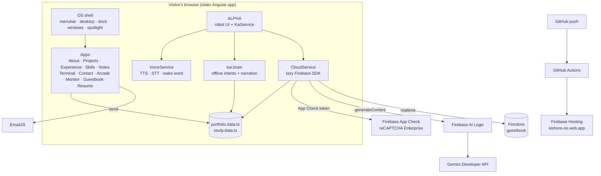
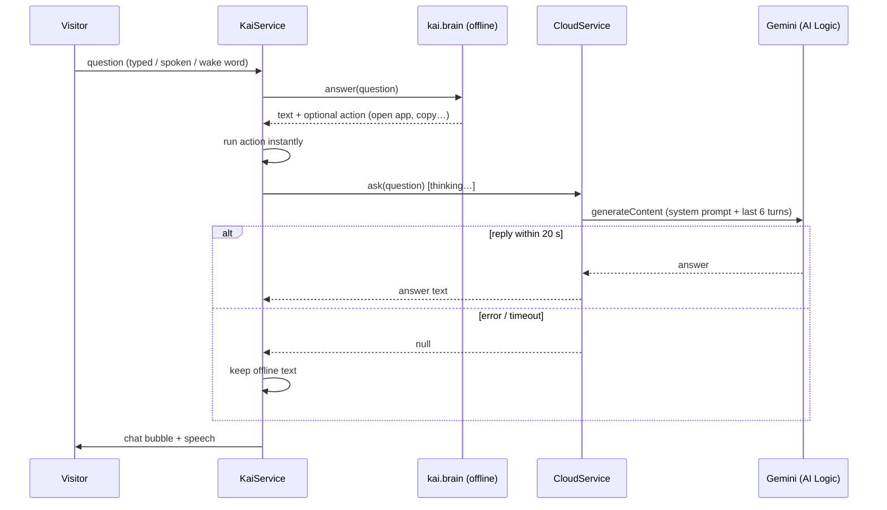
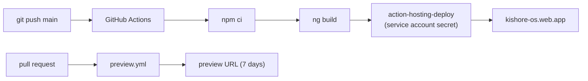

# Kishore.OS — Research & Development Notes

> How the portfolio was designed, built, connected to Firebase and shipped.
> Live: <https://kishore-os.web.app> · Repo: <https://github.com/Kishore1199/kishore-os>

---

## Contents
1. [Goal & concept](#1-goal--concept)
2. [Tech stack](#2-tech-stack)
3. [Architecture](#3-architecture)
4. [Project structure](#4-project-structure)
5. [The OS shell](#5-the-os-shell)
6. [ALPHA — the voice assistant](#6-alpha--the-voice-assistant)
7. [ALPHA — the robot](#7-alpha--the-robot)
8. [Apps](#8-apps)
9. [Firebase integration](#9-firebase-integration)
10. [Build, hosting & CI/CD](#10-build-hosting--cicd)
11. [Security decisions](#11-security-decisions)
12. [Performance & accessibility](#12-performance--accessibility)
13. [Problems faced & how they were solved](#13-problems-faced--how-they-were-solved)
14. [Testing](#14-testing)
15. [Known limitations](#15-known-limitations)
16. [Roadmap](#16-roadmap)

---

## 1. Goal & concept

**Goal:** a portfolio that is memorable, shows real engineering depth, and is still fast to scan for a recruiter.

**Concept — "Kishore.OS":** the portfolio is a tiny operating system in the browser. Each section (About, Projects, Experience, …) is an *app* that opens in a draggable window. A voice assistant, **ALPHA**, drawn as a mini robot, can narrate a guided tour, explain any window and answer questions out loud.

Iterations that led here (earlier versions are kept in sibling folders):

| Version | Idea | Why it moved on |
|---|---|---|
| `portfolio` | Classic single-page portfolio (Angular + Tailwind) | Functional but conventional |
| `portfolio-3d` | Scroll site with three.js hero, 3D skills, study-notes "chapter wall" | Good, but the brief was "extra creative" |
| `portfolio-summit` | Mountain/"climb" story with a 3D laptop | Too close to a reference site — rejected for originality |
| **`portfolio-os`** | **Browser OS + talking robot guide** | Original concept, uses the newest web platform APIs |

**Design principles**
- Original look and naming — no copying of reference sites.
- All content comes from data files; nothing is hard-coded in components.
- Never invent facts — every sentence ALPHA says is generated from the portfolio data.
- Works without a backend; cloud features degrade gracefully to offline behaviour.

---

## 2. Tech stack

| Layer | Choice | Why |
|---|---|---|
| Framework | **Angular 22** — standalone components, **signals**, **zoneless**, `OnPush` | Fine-grained reactivity, no Zone.js overhead, simple mental model |
| Language | TypeScript (strict) | Type-safe data + Firebase SDK |
| 3D / shader | **three.js** (lazy-loaded) | Aurora wallpaper GLSL shader |
| Voice | **Web Speech API** — `speechSynthesis` + `SpeechRecognition` | Free, on-device TTS; browser STT; no API keys |
| Animations | CSS + **View Transitions API** | Window open/close morphs with zero JS animation code |
| AI | **Firebase AI Logic → Gemini Developer API** | Real answers without a server; key never shipped to the browser |
| Database | **Cloud Firestore** | Real-time guestbook |
| Abuse protection | **Firebase App Check** (reCAPTCHA Enterprise) | Only the real site can call Gemini |
| Hosting | **Firebase Hosting** | CDN, HTTPS, SPA rewrites, free tier |
| CI/CD | **GitHub Actions** + `FirebaseExtended/action-hosting-deploy` | Push to `main` → live; PR preview URLs |
| Email | EmailJS | Contact form without a backend |
| Fonts | Syne (display), Inter (body), JetBrains Mono (code) | Distinctive headline + readable body |

---

## 3. Architecture



**State management:** three root services hold signals — `OsService` (windows, toasts, emotes), `VoiceService` (speaking/listening/level/wake word), `KaiService` (chat, tour, thinking). Components read signals directly; there is no store library.

---

## 4. Project structure

```
src/app/
├─ app.ts                 root: wallpaper, boot, shell, window layer, global shortcuts
├─ core/                  services & shared building blocks
│  ├─ os.service.ts       window manager, toasts, emote channel, narrator hooks
│  ├─ voice.service.ts    speech synthesis, recognition, wake word
│  ├─ kai.service.ts      chat, tour, ask (Gemini → offline fallback)
│  ├─ kai.brain.ts        narrations, tour script, offline intent matcher
│  ├─ cloud.service.ts    Firebase app, App Check, Gemini, Firestore (all lazy)
│  ├─ firebase.config.ts  public web config, reCAPTCHA site key, model name
│  ├─ theme.service.ts    dark/light (shared key with the study guides)
│  ├─ icon.ts · logo.ts · skill-icon.ts · brand-icons.ts · skill-meta.ts
├─ shell/                 the "operating system"
│  ├─ boot.ts  menubar.ts  desktop.ts  dock.ts  window.ts  spotlight.ts
│  ├─ wallpaper.ts        three.js aurora shader
│  ├─ kai.ts              ALPHA: chat panel, controls, drag, reactions
│  └─ robot.ts            ALPHA's SVG body, moods, touch zones
├─ apps/                  one component per app window
└─ data/                  portfolio.data.ts (CV content) · study.data.ts (generated)
```

---

## 5. The OS shell

### 5.1 Boot screen (`boot.ts`)
- Animated "BIOS" log built from real numbers (projects, skills, chapters).
- Two buttons: **Start the voice tour** / **Explore on my own**. The click doubles as the **user gesture browsers require before audio can play** — this is why speech works right after boot.
- Shown once per session (`sessionStorage`); deep links like `/#projects` skip straight to that app.

### 5.2 Window manager (`os.service.ts`, `window.ts`)
- Windows are plain objects in a signal: `{ id, x, y, w, h, z, min, max }`.
- `open / close / minimize / toggleMax / focus / move / resize` mutate that signal; the template renders one `<app-window>` per entry and projects the app inside with `@switch`.
- **View Transitions API:** every structural change runs inside `document.startViewTransition()`, and each window has `view-transition-name: win-<id>` — the browser morphs windows open/closed with no animation code. Falls back silently when unsupported or with reduced motion.
- Dragging and resizing use pointer events throttled with `requestAnimationFrame`.
- New windows open to the right of the desktop icon columns on wide screens, cascading by 28 px.
- On phones every window opens maximised (phone-app style).

### 5.3 Dock (`dock.ts`)
macOS-style magnification: on `pointermove`, each icon's scale is `1 + 0.55·cos(d/2 · π/2)` where `d` is its distance (in slots) from the cursor, written to a CSS variable. Running apps show a dot; clicking the front app minimises it.

### 5.4 Menu bar, Spotlight, desktop
- **Menu bar:** K logo menu, focused-app title, "Open to work" badge, wake-word mic, mute, theme, live **IST clock** (`Intl.DateTimeFormat`, `Asia/Kolkata`).
- **Spotlight (`Ctrl/⌘+K` or `/`):** one in-memory index over apps, actions, 6 projects, 58 skills and 84 study chapters; prefix > contains > subtitle ranking; arrow-key navigation.
- **Desktop:** app icons, a welcome widget and a tips note. On phones it becomes a home screen (icon grid + widget + 4-app dock).

### 5.5 Aurora wallpaper (`wallpaper.ts`)
A full-screen GLSL fragment shader on a three.js plane:
- **Domain-warped fBm noise** → flowing aurora ribbons in three theme colours (read from CSS variables, so light/dark switch instantly).
- Uniforms: time, mouse (parallax), **`uLevel` = ALPHA's voice level** — the aurora brightens and a ripple pulses from ALPHA's corner while it speaks.
- Rendered at **0.6× resolution and ~40 fps**, paused when the tab is hidden, static with reduced motion. three.js is loaded lazily so it never blocks first paint.

### 5.6 Theme
Design tokens are CSS custom properties on `:root` / `[data-theme='light']`. The theme key (`kv-theme`) is shared with the standalone study-guide HTML files so they open in the same theme.

---

## 6. ALPHA — the voice assistant

### 6.1 Speaking (`VoiceService.say`)
- `SpeechSynthesisUtterance` with the best available English voice (ranks "natural/neural/online" and Google voices, prefers en-IN → en-GB → en-US).
- **Word-boundary events** move a `charAt` signal and bump a `level` envelope (0…1) that decays every frame — this single number drives the robot's mouth, the aurora glow and the ripple.
- Some voices never fire boundary events → after 900 ms a **timed fallback** advances ~2.7 words/s.
- Chrome silently stops utterances longer than ~15 s → a 10 s `pause()/resume()` keep-alive.
- A token counter cancels stale utterances so tours, explanations and answers never overlap.

### 6.2 Listening (`VoiceService.listen`)
`SpeechRecognition` (`en-IN`, interim results) for a single question; interim text appears live in the chat; the final transcript goes to `KaiService.ask`.

### 6.3 Wake word — "Alpha"
- A second, **continuous** recognizer runs only when the visitor switches it on (mic button in the menu bar or chat).
- Trigger regex — the word must **start** the utterance (avoids "I like the alpha robot"):
  `^[\s,.]*(?:(?:hey|hi|hello|ok|okay|a)[\s,]+)?(?:alpha|alfa|elfa|alpa|alpah|elpha)\b`
- "Alpha, what are his skills?" → answers immediately; "Alpha" alone → "Yes? I'm listening." then listens.
- **Self-trigger protection:** the wake recognizer is aborted before every `say()` and held while speaking, listening, thinking or touring (an effect in `KaiService`).
- Chrome ends continuous sessions after silence → auto-restart after 350 ms; stops when the tab is hidden; turns itself off on `not-allowed`.
- Remembered in `localStorage`, but only auto-starts if `navigator.permissions` reports the mic as already **granted** — it never prompts unexpectedly.

### 6.4 The brain (`kai.brain.ts`)
- **Narrations** for every app and an 8-stop **tour script**, all built from `portfolio.data.ts` (e.g. the experience narration reads roles, companies and periods from data).
- **Offline intent matcher**: ordered rules for open-app commands, contact, resume, study chapters (fuzzy title words), projects (full title → keyword; *EMR before EHR* because both start with "75Health"), skills, experience, education, location, games, "how was this built", greetings.
- Each reply can also carry an action: open an app, open a link, copy text, start the tour.

### 6.5 Asking (`KaiService.ask`)

- **System prompt** = persona ("Alpha, here to assist you") + strict rules (only facts below, 2–4 spoken sentences, no markdown/emoji, steer back off-topic) + a facts block generated from the portfolio data.
- Keeps the last 6 turns for follow-up questions; strips markdown before speaking.
- `maxOutputTokens: 220`, `temperature: 0.6`, **request timeout 20 s**.

### 6.6 Guided tour
`KaiService.tour()` walks the script: minimises other windows, opens the next app, `await say(text)`, pauses 450 ms. Pause / skip / stop controls float above the robot. A run counter cancels a tour instantly when the visitor stops or skips.

---

## 7. ALPHA — the robot

### 7.1 Drawing (`robot.ts`)
Pure **SVG** (no images): pearl-white shell, glass visor face, ears, antenna, chest badge with the K logo, arms, hover-jet. The eyes and mouth are swapped per mood with `@switch`; everything else animates with CSS. One CSS variable, `--mood`, recolours the antenna, ears, hands, chest ring and jet glow.

### 7.2 The 18 moods

| Mood | Trigger | Visual |
|---|---|---|
| idle | default | soft smile, blinking, **eyes follow the cursor** |
| happy | hover | `^ ^` eyes, grin, arms up |
| talk | speaking | mouth opens with voice level, waving |
| listen | mic / thinking | round curious eyes, head tilt |
| wink | after speaking, every ~14 s idle | one-eye wink |
| love | double-tap, "thanks/awesome…" in chat | heart eyes, floating hearts |
| sleep | 40 s inactivity | closed eyes, snore bubble, Z z z |
| yawn | 36 s inactivity | big stretching yawn |
| blink | tap face | quick double blink |
| giggle | tap tummy | `> <` eyes, laughing, wiggle |
| dizzy | tap head / antenna | spiral eyes, orbiting stars |
| highfive | tap hands | raised glowing hand |
| shy | tap ears | looks away, deep blush |
| angry | 5 taps in 2.5 s | red eyes, steam, shaking |
| wow | open Projects, tour ends, wake word | spinning star eyes, sparkles |
| cool | theme switch | sunglasses drop in |
| sad | no answer / mic heard nothing | droopy eyes, tear |
| party | copy email/phone, contact sent, guestbook note | confetti burst |

### 7.3 Interaction details (`kai.ts`)
- **Touch zones:** transparent SVG shapes over face/head/ears/belly/hands emit a `touched` output; a short-lived `react` signal overrides the mood for N ms.
- **Emote channel:** any part of the app calls `os.react('party')` — a signal with a counter so repeated identical emotes still fire.
- **Drag anywhere:** pointer down + >6 px movement = drag (a tap still triggers reactions); position clamped to the viewport, saved in `localStorage`, snaps home when dropped near the corner; the click after a drop is swallowed.
- **Eye tracking:** `pointermove` (rAF-throttled) writes `--ex/--ey` CSS variables — no Angular change detection per mouse move.
- **Voice level → mouth:** an effect writes `--lv` on the host element each frame.

---

## 8. Apps

| App | Notes |
|---|---|
| About | logo avatar, stats computed from data, highlights, "currently" strip |
| Projects | Finder-style list + detail with browser-framed screenshot (16:10, no cropping); registers a **narrator** so "Explain" reads the selected project |
| Experience | timeline with per-role 🔊 buttons + education cards with score meters |
| Skills | 58 skills with brand logos (Simple Icons paths), category tabs + filter |
| Study Notes | 84 interview-prep chapters grouped by area, search, deep links into the HTML guides |
| Terminal | ~20 commands (`help`, `ls`, `open`, `notes`, `theme`, `tour`, `say`, `alpha`, `sudo hire kishore`…), history (↑/↓), Tab completion |
| Contact | copy buttons + reactive form → EmailJS (SDK lazy-loaded on submit) |
| Guestbook | live Firestore sticky-note wall, colour picker, 1 note/min client cooldown |
| Arcade | Bug Squash (20 s) + Stack Match (memory), best scores in `localStorage` |
| System Monitor | live FPS/load/viewport/theme/WebGL readouts + clickable architecture maps |
| Resume | PDF in an iframe + download |

---

## 9. Firebase integration

### 9.1 Lazy loading (`cloud.service.ts`)
`firebase/app`, `firebase/app-check`, `firebase/ai` and `firebase/firestore` are all **dynamic imports**. Nothing Firebase-related downloads until ALPHA asks Gemini or the Guestbook opens. If `firebase.config.ts` is empty the whole layer is disabled and the site runs offline.

### 9.2 Gemini via Firebase AI Logic
```ts
const ai = getAI(app, { backend: new GoogleAIBackend() });
const model = getGenerativeModel(ai,
  { model: GEMINI_MODEL, systemInstruction: SYSTEM, generationConfig: { maxOutputTokens: 220, temperature: 0.6 } },
  { timeout: 20000 });
await model.generateContent({ contents: [...lastTurns, { role: 'user', parts: [{ type: 'text', text }] }] });
```
- The Gemini API key lives **inside Firebase**, never in the site.
- SDK v13 note: text parts need `type: 'text'` (older docs omit it).
- Model is a single constant (`gemini-4-hydrogen`, free tier) because Google retires models over time.

### 9.3 App Check
reCAPTCHA Enterprise **score-based** key restricted to `kishore-os.web.app` / `kishore-os.firebaseapp.com`. On `localhost` the code sets `FIREBASE_APPCHECK_DEBUG_TOKEN = true`; the printed debug token is registered with `firebase appcheck:debugtokens:create`.

### 9.4 Guestbook (Firestore)
Collection `guestbook`, ordered by `createdAt`, `onSnapshot` for live updates. **Security rules** (`firestore.rules`):
- read: anyone; update/delete: nobody (moderate from the console)
- create only if keys are exactly `name, message, color, createdAt`, name 2–40 chars, message 3–240 chars, colour in a fixed list, and `createdAt == request.time` (server timestamp — no back-dating)
- everything else in the database is closed.

---

## 10. Build, hosting & CI/CD

- `npm start` → dev server on `:4500`; `npm run deploy` → `ng build` + `firebase deploy --only hosting,firestore`.
- **Hosting (`firebase.json`):** SPA rewrite to `index.html`, immutable 1-year cache for hashed JS/CSS/images, `no-cache` for `index.html`, 1-hour cache for the study guides.
- **GitHub Actions:**
  - `deploy.yml` — on push to `main`: checkout → Node 22 → `npm ci` → `ng build` → deploy to the **live** channel.
  - `preview.yml` — on pull requests: same build → temporary **preview channel** (7 days), URL commented on the PR.
- Deploy identity: service account **`github-deployer`** with *Firebase Hosting Admin*, *Firebase Viewer*, *Service Usage Consumer*, *API Keys Viewer*; JSON key stored only as the repo secret `FIREBASE_SERVICE_ACCOUNT_KISHORE_OS`.



---

## 11. Security decisions

| Risk | Mitigation |
|---|---|
| Leaking the Gemini key | Not in the client at all — Firebase AI Logic holds it |
| Others draining the AI quota | App Check (reCAPTCHA Enterprise) enforced; default 100 req/min/user limit |
| Guestbook spam / tampering | Strict Firestore rules, server timestamps, no edits/deletes, client cooldown, console moderation |
| Deploy credentials | Least-privilege service account; key only in GitHub Secrets; `*.json` keys and `.env` git-ignored |
| Firebase web config "exposure" | Public by design; protection comes from rules + App Check |
| Always-on microphone | Wake word is opt-in, shows a 👂 badge, pauses while ALPHA talks and when the tab is hidden |
| Wrong git identity | Repo-local identity (`Kishore V <personal email>`) and a username-scoped remote, so the work account is untouched |

---

## 12. Performance & accessibility

- **Initial JS ≈ 130 kB gzipped**; three.js (~122 kB gz) and Firebase (~123 kB gz) are lazy chunks.
- Wallpaper at reduced resolution & frame rate; paused when hidden.
- Per-frame values (voice level, eye position) go to **CSS variables**, not component state.
- `prefers-reduced-motion`: animations collapse, the shader renders one frame, View Transitions are skipped.
- Keyboard: `Ctrl/⌘+K`, `/`, `Esc`, arrow keys in Spotlight, Tab completion in Terminal; windows are `role="dialog"` with labels; icon buttons have `aria-label`s.
- Phones: home-screen layout, full-screen apps, safe-area insets, touch dragging without page scroll.

---

## 13. Problems faced & how they were solved

| Problem | Cause | Fix |
|---|---|---|
| Speech didn't play on load | Autoplay policy needs a user gesture | Boot screen buttons start the voice tour |
| Captions froze on some voices | No `boundary` events | Timed word fallback after 900 ms |
| Long narration cut off in Chrome | ~15 s utterance limit | Periodic `pause()/resume()` keep-alive |
| ALPHA answered "75Health EMR" with the EHR | Both titles start with "75Health" | Full-title match first, then EMR before EHR keywords |
| Syne 800 stats overflowed | Ultra-wide display weight | Switched to 700 + tighter letter-spacing |
| Robot touch reactions vs. opening chat | Both on click | Chat moved to the name tag; robot body = reactions |
| Drag also triggered a reaction | Click fires after pointerup | `justDragged` flag swallows the next click |
| `type 'Part[]'` TypeScript error | Firebase AI SDK v13 requires `type: 'text'` | Added the discriminator |
| Gemini 400 "genai config not found" | AI Logic not linked to the Gemini Developer API | Completed AI Logic → Get started in the console |
| Gemini 401 "App Check token invalid" | Localhost has no reCAPTCHA | Registered an App Check debug token via CLI |
| Gemini requests hanging | Upstream "high demand" on the free tier | 20 s timeout → offline fallback (never blocks the visitor) |
| `git push` 403 | Windows cached the *work* GitHub account | Username-scoped remote `https://Kishore1199@github.com/…` |
| CI "firebaseServiceAccount not supplied" | Secret missing / wrong section | Added repository secret with the exact name |
| CI "caller does not have permission" | Service account had no roles | Granted Hosting Admin, Firebase Viewer, Service Usage Consumer, API Keys Viewer |
| Guestbook hard to find | Only a desktop icon, covered by windows | Added to dock + K menu; windows open beside the icons |
| Secrets pasted into chat | — | Keys rotated; documented "never paste secrets" in the setup guide |

---

## 14. Testing

Verified manually in Chrome (desktop 1440×860, laptop 1366×657, phone 390×844, dark & light):
- boot → tour (captions/controls), explain buttons, chat Q&A, terminal commands, Spotlight
- every robot mood, touch zone, drag/drop/snap, sleep/wake
- wake-word regex against sample transcripts (positive + negative cases)
- Guestbook write → live read on localhost and production; Firestore rules deployed
- App Check token exchange (200) and Gemini fallback path (timeout → offline answer)
- scroll/interaction smoothness ~60 fps; production build budgets
- CI: build passes; deploy succeeds after roles were granted

Not testable in automation: real microphone input (wake word / voice questions) — verified by logic tests and manual use.

---

## 15. Known limitations

- **Gemini availability:** free-tier capacity can be busy; ALPHA falls back to offline answers after 20 s.
- **Speech recognition:** Chrome, Edge, Safari only (not Firefox); Chrome/Edge process audio on Google/Microsoft servers.
- **Voice quality** depends on the voices installed in the visitor's browser/OS.
- **Guestbook moderation** is manual (console).
- Study-guide pages are static HTML generated outside this repo.

---

## 16. Roadmap

- Case-study pages for 75Health EHR/EMR (problem → role → architecture → results), narrated by ALPHA.
- ALPHA in Tamil and Hindi (`ta-IN`, `hi-IN` voices + prompts).
- Live GitHub widget (repos, contribution graph).
- PWA: installable app + offline study notes.
- "Hire me" vCard + QR code.
- Custom domain + Open Graph preview image.
- Remote Config for the Gemini model name; streaming answers (`generateContentStream`) for faster first words.
- Unit tests for `kai.brain` intents and the wake-word matcher; Playwright smoke tests in CI.
